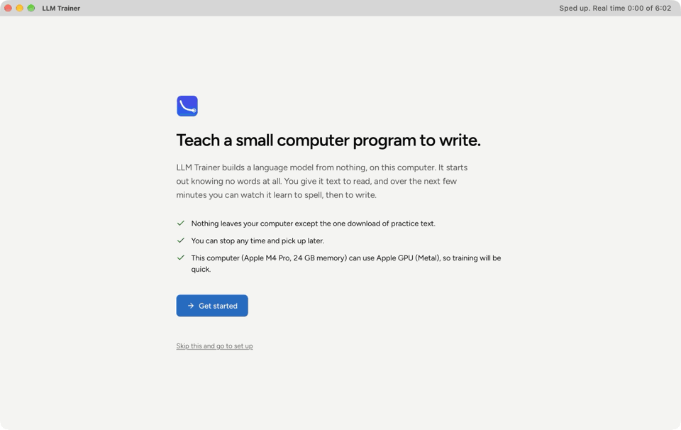
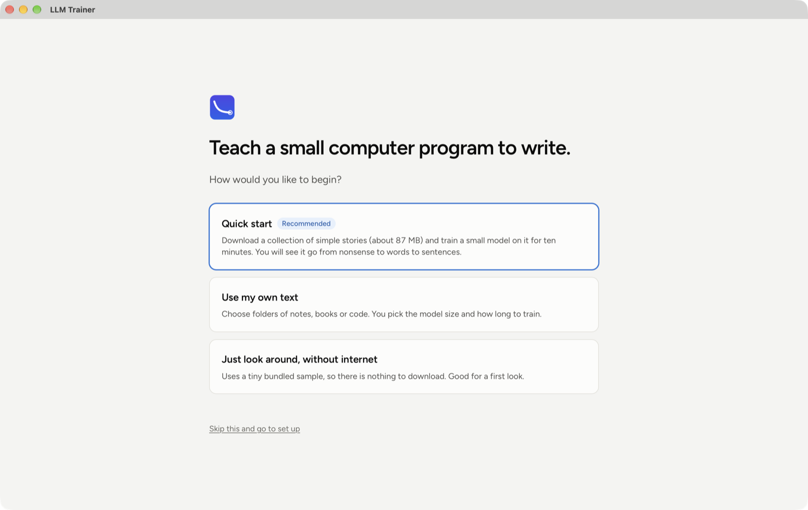
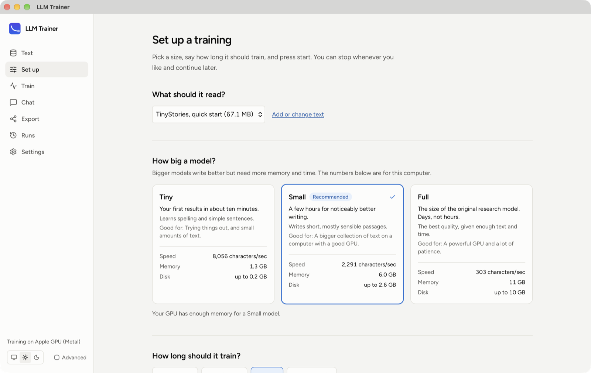
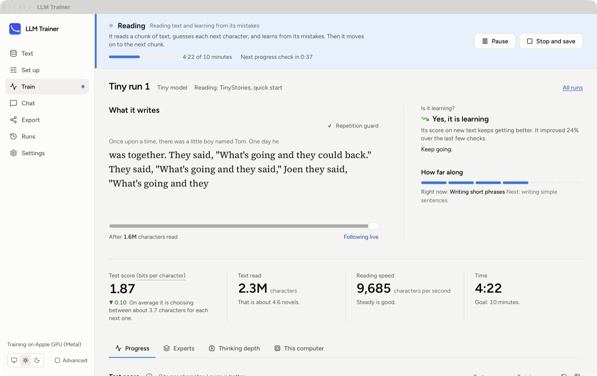
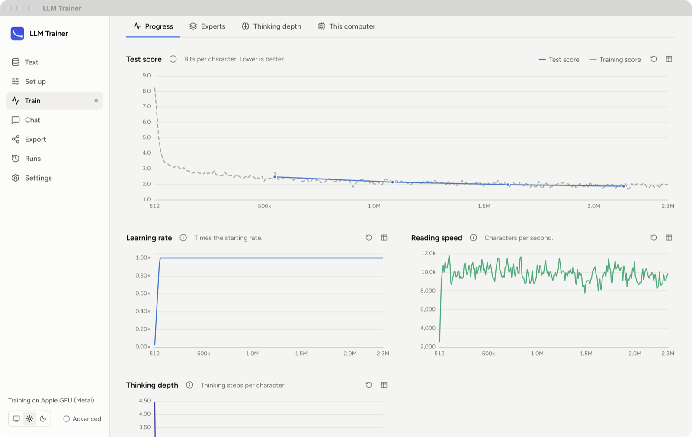
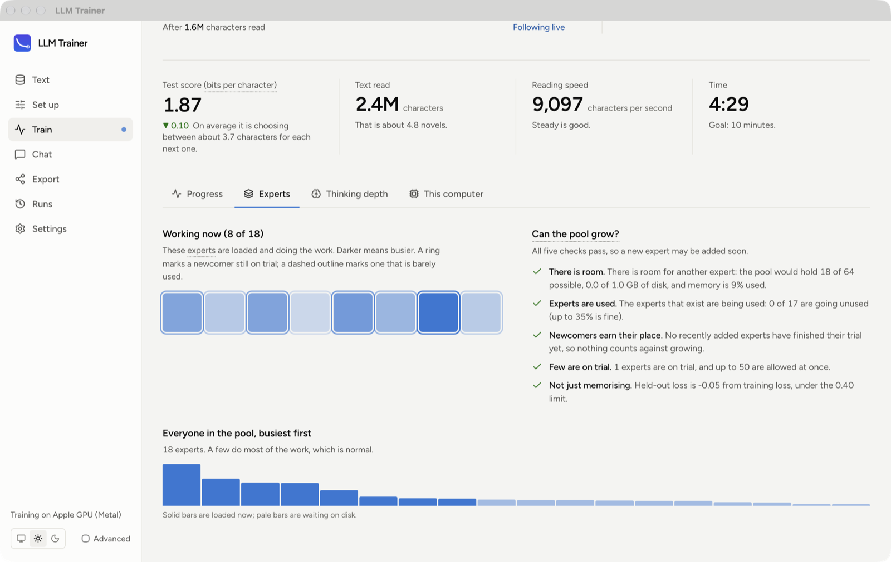
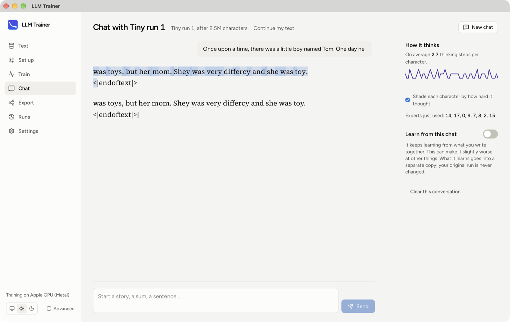
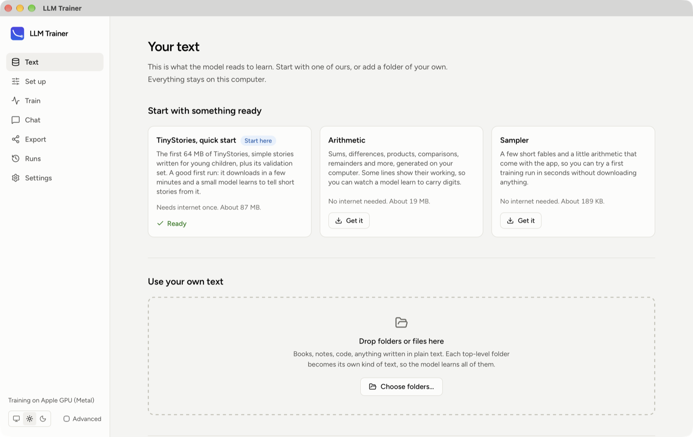
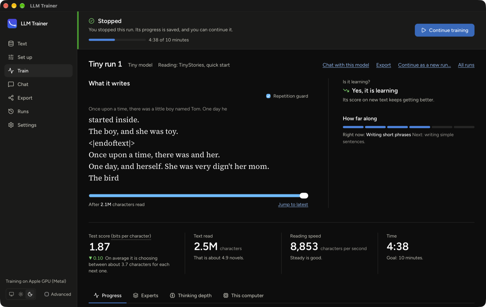

# LLM Trainer

**Train a small language model from scratch on your own computer, and watch it learn to write.**



*A real recording of the app, sped up. Quick Start downloads some children's stories, trains a Tiny model on an Apple M4 Pro for about four and a half minutes, then the model is asked to continue a sentence. The caption in the title bar shows the real time that had passed. [Watch it as a 47-second MP4](docs/media/demo.mp4).*

LLM Trainer is a desktop app for people who have never trained a model. You pick some text and a size, press start, and it shows you in plain English what the program is doing, how far along it is, and whether it is learning. By default nothing is simulated: the model is built and trained on your own machine, on its GPU if it has one.

The project was inspired by [mini-AGI](https://github.com/volotat/mini-AGI): a byte-level language model that starts out knowing nothing, keeps learning as it reads, can "think longer" about hard characters, and routes each character through a pool of small expert networks that grows and shrinks during training.

## What you can do

- **Start with one click.** Quick Start downloads a collection of simple stories (87 MB), sets up a small model and trains it for ten minutes. You see it go from nonsense to words.
- **Teach it your own text.** Drop folders of notes, books or code on the window. Each top-level folder becomes its own kind of text, so you can see how well it learns each one.
- **Choose a size.** Tiny, Small or Full (the size of the original research model), with speed and memory estimates for the computer you are on.
- **Always know what is happening.** A banner names the current stage in plain words, with a progress bar and the time to the next check-up. An "Is it learning?" verdict tells you whether to keep going. Every chart has a "what is this?" note.
- **Watch it learn to write.** After every check-up the model is asked to continue a few openings. Slide back through time to read what it wrote at each point.
- **Look inside.** See which experts are working, whether the pool may grow, and how many thinking steps each character gets.
- **Chat with it.** Continue your text, or ask a question. Optionally let it learn from the chat, on a private copy so your original run is never changed.
- **Keep, compare and share.** Every run is saved. Stop and continue later, continue as a new run with different settings, compare runs side by side, export the weights, or import a model from the original mini-AGI.
- **Stay on your computer.** The only download is the practice text you ask for. Runs, metrics and chats live in a local SQLite database.

## A tour



*First launch. Three ways to begin; Quick start is the recommended one.*



*Set up. Pick the text and a size. The numbers are estimates for the computer you are on, and a size that will not fit is disabled with the reason.*



*Training, live. The banner says what the program is doing and when the next check-up is. The model's latest writing sits under the prompt it was given. On the right: the verdict, and how far along the learning is. Below: test score in bits per character (lower is better), text read, speed and time.*



*Progress charts. The test score is measured on text the model has never read, so it shows real learning rather than memorising. These are from the same run, after about four and a half minutes.*



*Experts. Which experts are working right now, and the five checks that decide whether the pool may grow.*



*Chat. The model continues the sentence it is given. Each character is shaded by how hard the model thought about it, and the panel on the right shows the thinking steps and which experts were used.*



*Text. Ready-made starters, or drop in your own folders.*



*Dark theme. A stopped run, ready to continue, chat with or export.*

### What to expect

The screenshots and video above come from one real Quick Start run: a Tiny model on an M4 Pro, stopped after 4 minutes 38 seconds with a test score of 1.87 bits per character. At that point it writes mostly real words in short phrases and rarely a sensible sentence. Longer runs and bigger sizes get further; the point of the app is that you can see that happen.

## Install

There are no prebuilt installers yet, so build it from source. You need [Rust](https://rustup.rs) 1.93 (the repository pins it), Node 24 and pnpm 10.

```sh
git clone https://github.com/Fazmin/LLMTrainer.git
cd LLMTrainer
pnpm install
pnpm tauri build --bundles app     # on macOS: target/release/bundle/macos/LLM Trainer.app
```

| Platform | State |
|---|---|
| macOS, Apple Silicon | Built, trained on and tested. Uses the Apple GPU (Metal) on macOS 15 or newer, and the processor on older versions. |
| Windows, Linux | Not built or tested yet. The code is written to be cross-platform, but nothing has been built or run there. |
| NVIDIA GPUs | No build is provided. The engine has a `cuda` cargo feature that has not been tried. |

The app identifier is still the placeholder `com.example.llmtrainer`. Change it in `src-tauri/tauri.conf.json` before you sign or distribute a build.

## Sizes, speed and memory

Measured on an Apple M4 Pro with 24 GB of memory:

| Preset | For | Speed | Peak memory |
|---|---|---|---|
| Tiny | Trying things out, small amounts of text | about 10,000 characters per second | about 1 GB |
| Small | A bigger collection of text on a computer with a good GPU | about 2,500 characters per second | about 3 to 5 GB |
| Full | The size of the original research model | about 350 characters per second | about 12 to 15 GB |

Full recomputes each thinking step while it learns, so its memory does not grow with depth. It has only been run for short stretches, never for a long training. The Set up screen shows estimates for your own machine before you start. Treat its memory figure as a rough guide, not a promise.

## How it works

- **A byte-level model.** It reads raw bytes (256 of them plus 9 marker tokens), so there is no tokenizer to build and any text works.
- **Thinking longer.** A few dense layers feed one weight-shared block that is applied up to several times per character. A halting head decides when each character has thought enough; characters that stop early are frozen and later characters read what they left behind.
- **A pool of experts.** Every expert is a file. Recently used ones stay in memory, and a fixed number of slots on the GPU hold the ones the current text asked for. The pool grows by recombining existing experts, and shrinks by deleting ones nothing has asked for in a long time.
- **Learning as it reads.** One optimiser step per chunk of text. A controller steers the learning rate from the held-out score, and the context window grows as training goes on.
- **Checkpoints in the original's layout.** A model trained here loads in the Python original, and the original's checkpoints import here.

### How faithful is the engine?

The engine is held to the original by **golden tests**: fixtures written by the Python reference (`tools/golden/`) are replayed in Rust and must match. They cover the tensor primitives, the whole recurrent forward (halting, frozen characters, the PonderNet loss, eight variants), cached inference, expert admission and routing (including capacity drops and the exploration bonus), four real AdamW steps with experts paged in and out of the card, greedy decoding with the adaptation trace, and the tokenizer. A model trained and saved by the Rust engine scores the same text identically (to six digits) when loaded in the original Python code.

Deliberate differences: capacity drops are decided in token order (the original's order is unspecified), non-finite steps are skipped instead of poisoning the weights, and a fresh model is created from the preset rather than from `config.yaml`. [docs/engine.md](docs/engine.md) has the details and the traps found along the way.

## Status

Built and tested on macOS (Apple Silicon): the app, the real engine on Metal, and a real TinyStories Quick Start run through the desktop window. About 560 Rust tests and 17 UI tests passed at the last full run, with clippy and the accessibility audit clean.

Not done:

- Nothing has been built or run on Windows or Linux.
- There are no continuous-integration workflows checked in, so nothing runs the tests automatically.
- The Full preset has not been trained for long.
- The macOS build is unsigned and not notarised.
- The engine's GPU kernels are not fused, so there is speed left on the table (see the performance notes in [docs/engine.md](docs/engine.md)).

## Develop

```sh
pnpm install

# the desktop app with the real engine
MINAGI_HOME=$PWD/.dev-data pnpm tauri dev

# the same app with a simulated engine (curves and text are made up, and the app says so)
MINAGI_ENGINE=mock MINAGI_HOME=$PWD/.dev-data MINAGI_MOCK_SPEED=20 pnpm tauri dev

# just the UI in a browser, against an in-browser simulation (fastest way to iterate on screens)
pnpm dev:web             # http://127.0.0.1:1420
node scripts/shots.mjs   # walks the app in headless Chromium and saves screenshots to ./shots
node scripts/axe.mjs     # accessibility audit of every screen in both themes

# train from the command line, no app
cargo run --release -p minagi-cli --bin minagi_train -- --synthetic --preset tiny --backend metal --minutes 1
```

`MINAGI_HOME` is where the app keeps its data (the database, text, runs). `MINAGI_MOCK_SPEED` is how many times faster than real time the simulation runs. `MINAGI_MOCK_SCENARIO` can be `plateau`, `diverge`, `overfit`, `oom`, `diskfull` or `nogpu` to exercise the error and warning screens. Build with `--no-default-features` to leave the real engine (and candle) out while working on screens.

### Layout

```
crates/minagi-types   shared contract: config and presets, events, traits, insight helpers (no ML dependencies)
crates/minagi-store   SQLite: migrations, a single writer thread, chart downsampling, crash recovery
crates/minagi-mock    simulated engine and generator, held to the same contract as the real one
crates/minagi-data    dataset manager: folder scan, lanes, split, starter downloads, arithmetic generator
crates/minagi-text    byte tokenizer, round-robin training stream, held-out evaluation chunks
crates/minagi-core    the ML engine on candle: ops, model, expert pool, optimiser, trainer, chat, checkpoints
crates/minagi-cli     command-line tools: train, benchmarks
src-tauri             the desktop app: commands, the recorder, session control
ui                    React + TypeScript frontend, charts in ECharts
tools/golden          Python reference dumps used by the parity tests (see its README)
scripts               screenshot, accessibility and media tooling
docs                  engine notes, spike results, and the README's images and video
```

How a run flows: the engine thread emits events; the **recorder** thread persists them to SQLite once a second, throttles them into a live stream (at most 4 updates a second) for the UI, and works out the plain-English verdict and time estimate. The UI reads history from SQLite through typed commands and live state from the stream.

### Tests

```sh
cargo test --workspace --exclude llm-trainer-app     # engine, data, store, mock, types
cargo test -p llm-trainer-app                        # the app, including full workflows with the real engine
pnpm --filter ui typecheck && pnpm --filter ui test
cargo clippy --workspace --all-targets -- -D warnings
```

The TypeScript bindings in `ui/src/bindings.ts` are generated from the Rust types (`cargo test -p llm-trainer-app export_bindings`). The Python reference fixtures are regenerated with `.venv/bin/python tools/golden/dump_model.py` (needs the reference cloned into `tools/golden/ref`).

### Re-recording the screenshots and video (macOS)

The images in `docs/media` are captures of the real app window, not mock-ups. A debug build has a hook that runs a script inside the window, so the whole tour can be driven without a person clicking. The capture script records that one window only, never the screen.

```sh
pnpm tauri build --debug --no-bundle                  # a debug build keeps the hook; the UI is embedded
export MINAGI_HOME=$(mktemp -d)
rm -f /tmp/minagi-dev-report.log                      # the tour announces its moments here
scripts/media/capture.sh /tmp/media &                 # frames and named stills of the app window
MINAGI_DEV_SCRIPT=$PWD/scripts/dev/readme_tour.js target/debug/llm-trainer-app
```

`readme_tour.js` does the first-run Quick Start through training. `readme_tour_chat.js` covers chat, the other screens and the dark theme; run it the same way after quitting the app and deleting the report log, with the same `MINAGI_HOME` (it needs the finished run) and a new capture folder. The window follows the theme saved in the app, so if your Mac is in dark mode, start the app once with a throwaway `MINAGI_HOME`, choose "Skip this and go to set up", click the sun in the sidebar, and quit. The choice is remembered.

The Swift encoder turns a folder of frames (sorted by name, timed by their file modification dates) into the MP4 and the GIF, and needs nothing but the macOS developer tools. The published clip joins the frames of both passes, copied in order with `cp -p`:

```sh
swiftc -O scripts/media/encode.swift -o /tmp/encode
/tmp/encode FRAMES_DIR docs/media 12 150 48   # mp4 fps, gif frame budget, and how many closing frames play slower
```

The display must stay awake while recording, because a sleeping display gives blank captures; `capture.sh` keeps it awake for you.

## Credits and licence

Based on [mini-AGI](https://github.com/volotat/mini-AGI) by volotat (MIT). Starter text comes from [TinyStories](https://huggingface.co/datasets/roneneldan/TinyStories) (CDLA-Sharing-1.0). LLM Trainer itself is released under the [MIT licence](LICENSE).
